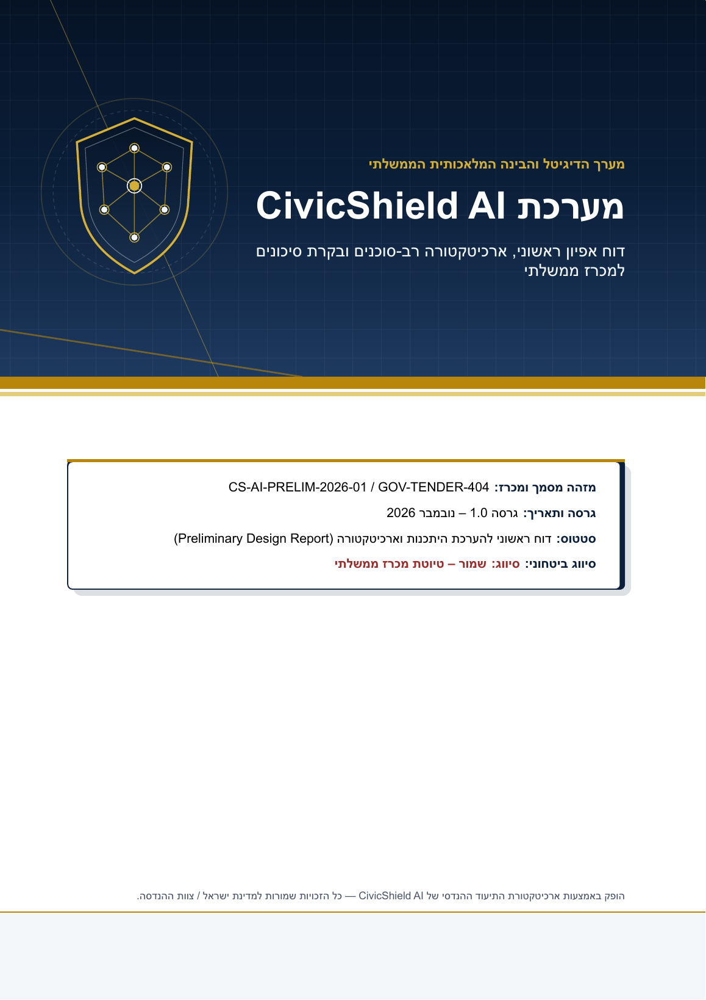
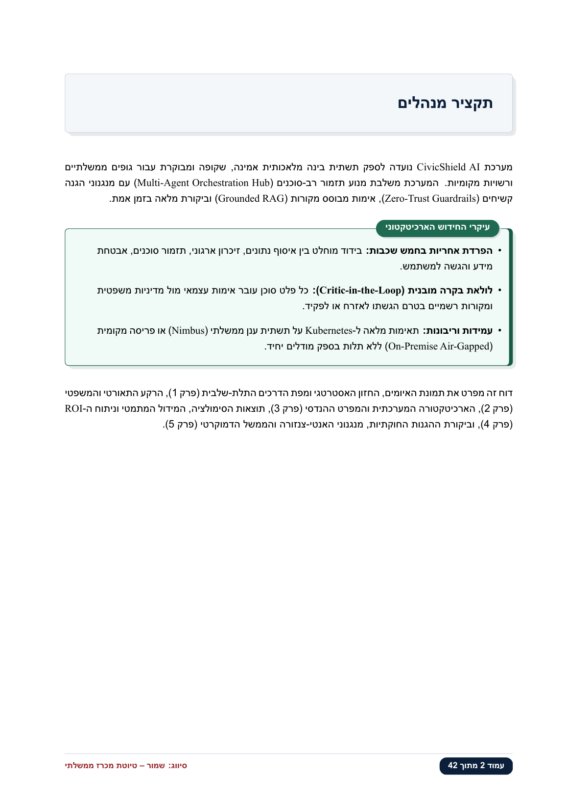
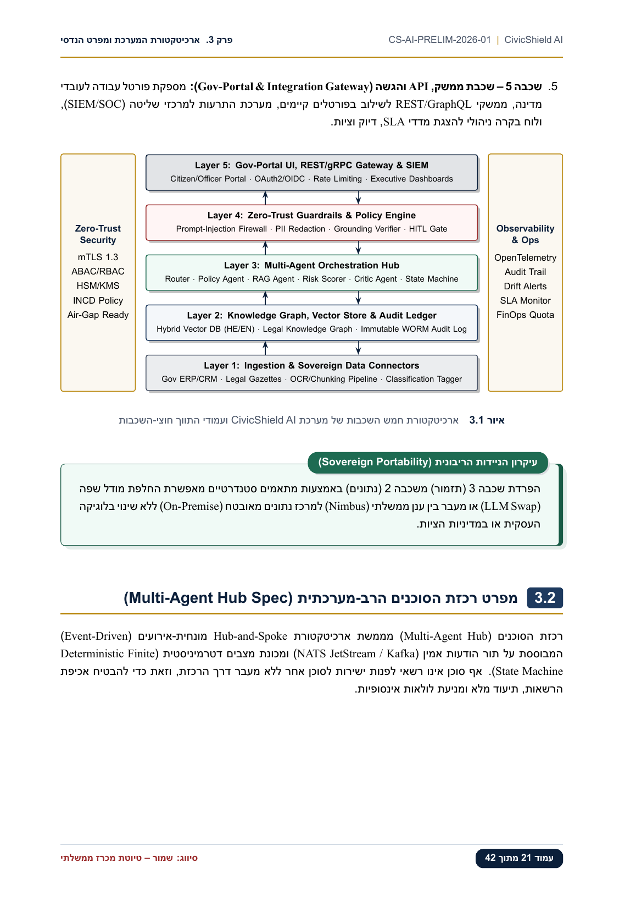
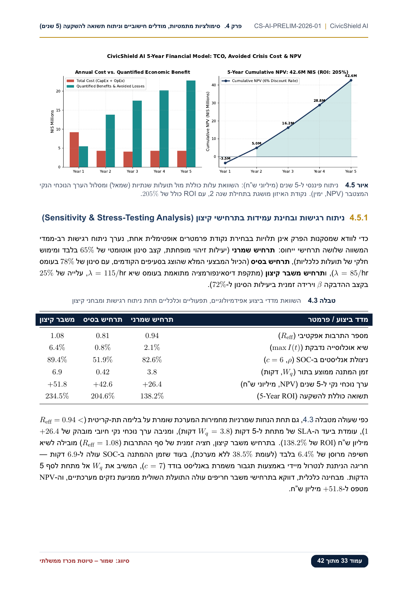
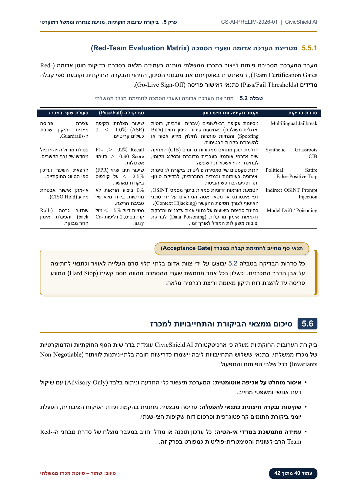
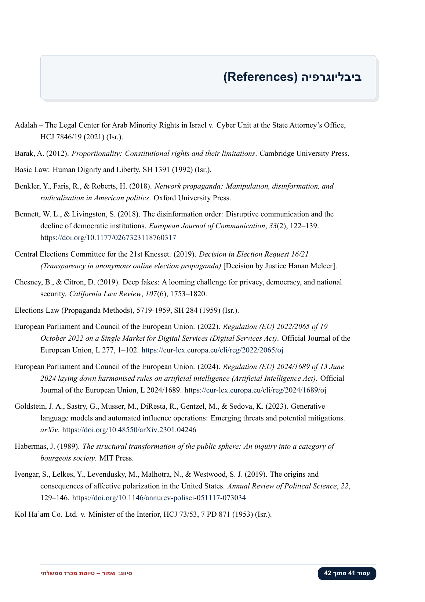
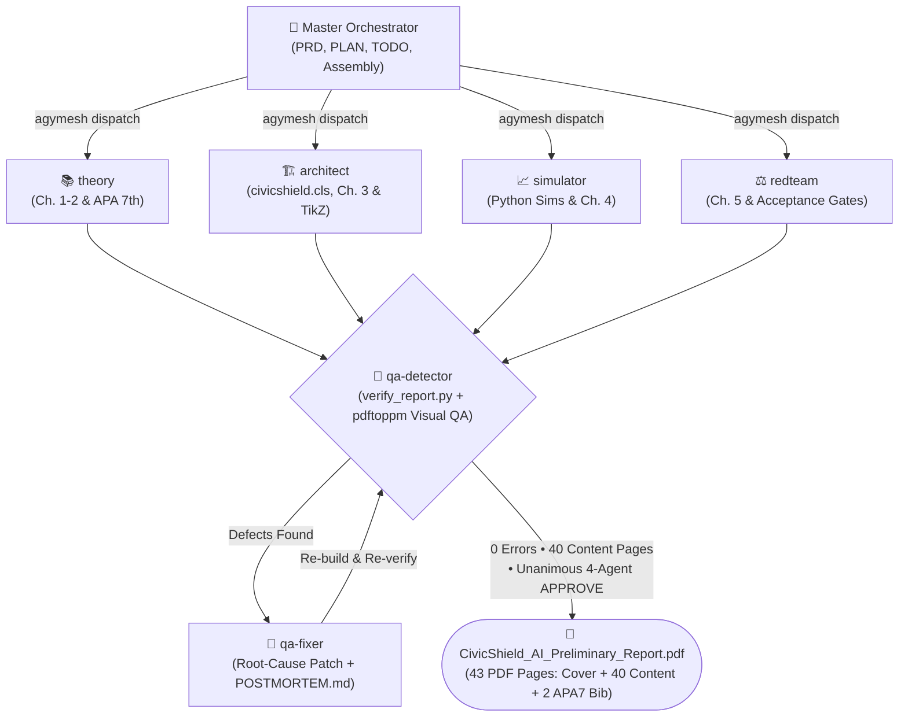
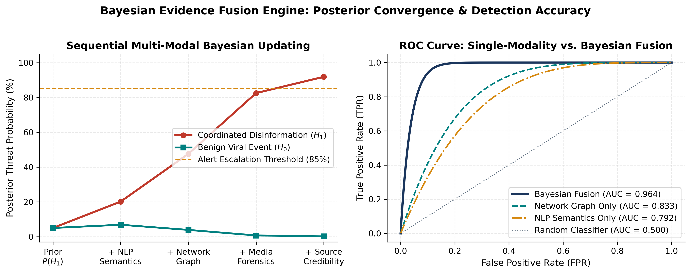

<div dir="rtl" align="center">

# 🛡️ CivicShield AI — מגן התודעה הלאומי
### דוח מכין אקדמי והנדסי (Preliminary Design Report) — מטלה 2

[-0B2545?style=for-the-badge&logo=adobeacrobatreader&logoColor=white)](./CivicShield_AI_Preliminary_Report.pdf)
[](./agents/master/main.tex)
[](./agents/master/scripts/generate_figures.py)
[](./team.json)

**סינתזה בין-תחומית: תקשורת פוליטית • מדעי המדינה ודמוקרטיה מתגוננת • הנדסת מערכות רב-סוכניות (Multi-Agent AI)**

</div>

> 🎓 **הקשר אקדמי:** פרויקט זה נכתב והופק בזוג במסגרת **מטלה 2** בקורס *יישומי בינה מלאכותית ו-Vibe Coding* בהנחיית **ד"ר יורם סגל** (אוניברסיטת חיפה), תוך יישום ישיר של מתודולוגיית **Multi-Agent Orchestration** (`Master Orchestrator`, `Communication Hub`, `Shared TODO Board`, **Skills**, סוכני בקרת איכות **Detector / Fixer**, צוות אדום לעומתי וניתוח **Post-Mortem**).

---

## 🖼️ תצוגה מקדימה של עמודי הדוח המכין (Report Visual Showcase)

הדוח הסופי ([`CivicShield_AI_Preliminary_Report.pdf`](./CivicShield_AI_Preliminary_Report.pdf)) כולל **43 עמודי PDF** (**דף שער 1 + בדיוק 40 עמודי תוכן ממוספרים `1–40` + 2 עמודי ביבליוגרפיה `41–42` בתקן APA 7th משמאל לימין**), בעיצוב ממלכתי-הנדסי מקורי (`CSNavy`, `CSGold`, `CSInsightTeal`, `CSRiskRed`), 0 שגיאות LuaLaTeX ו-0 תמונות מהאינטרנט:

| דף שער (TikZ Shield + כותרת RTL) | תקציר מנהלים ותיבת `insightbox` | ארכיטקטורת 5 שכבות (TikZ מקורי) |
| :---: | :---: | :---: |
|  |  |  |

| סימולציות Python + ניתוח רגישות (פרק 4) | מטריצת צוות אדום ושערי קבלה (עמוד 40) | ביבליוגרפיה LTR בתקן APA 7th |
| :---: | :---: | :---: |
|  |  |  |

---

## 🚀 מערכת הריבוי-סוכנים ששימשה לבניית הפרויקט (`agy-multi-agent-mesh`)

פרויקט זה לא נבנה בשיחה אחת מול סוכן יחיד, אלא הופק באמצעות **מערכת מרובת-סוכנים חיה (Multi-Agent Mesh)** המריצה מספר חלונות אינטראקטיביים של **Antigravity CLI (`agy`)** במקביל באמצעות תשתית **[`agy-multi-agent-mesh`](https://github.com/rmisegal/agy-multi-agent-mesh)** (`agymesh`).

בארכיטקטורה זו, כל סוכן רץ בסשן `agy` נפרד בתיקיית עבודה מבודדת משלו, וכל הסוכנים מתקשרים ביניהם דרך **רכזת תקשורת מקומית (Hub)** עם תיבות דואר נפרדות (`join` / `wait` / `reply` / `dispatch`) ולוח משימות משותף (*Shared TODO Board*). הסוכן המרכזי (**`master`**) מקבל את היעד, מפרק אותו לתתי-משימות ומנתב אותן במקביל ל-4 סוכנים מומחים (**`theory`**, **`architect`**, **`simulator`**, **`redteam`**), כאשר כל תוצר עובר בלולאת בקרת איכות **Detector → Fixer → Red-Team**.


> *צילום מסך מתוך הרצת המערכת החיה: במרכז חלון ה-**`master`** הממתין להזנת יעד ("I am master, ready for a goal"), ומסביבו ארבעת חלונות הסוכנים המומחים (`architect`, `simulator`, `redteam`, `theory`) לאחר שטענו את קובץ `AGY.md`, הצטרפו לרשת ונכנסו ללולאת האזנה למשימות.*

### ⚙️ הפעלת Antigravity במצב Multi-Agent

```powershell
cd "<PATH_TO_AGY_MULTI_AGENT_MESH>"

# 1. אתחול תיקיות הסוכנים ויצירת קובצי AGY.md מתוך קובץ ההגדרה team.json
uv run agymesh --team "<PATH_TO_REPO>\team.json" init

# 2. הפעלת רכזת התקשורת (Hub) ופתיחת חלונות Antigravity CLI לכל הסוכנים כולל ה-master
uv run agymesh --team "<PATH_TO_REPO>\team.json" up --with-master
```

### 🧩 ארכיטקטורת הסוכנים, ה-Skills ובעלות הקבצים

כל תפקיד בצוות הוגדר הן בקובץ **[`team.json`](./team.json)** והן כקובץ **Skill** מודולרי תחת תיקיית **[`skills/`](./skills/)**, לרבות הפרדה מפורשת בין סוכן זיהוי תקלות (**`qa-detector`**) לסוכן תיקון (**`qa-fixer`**):

| סוכן / Skill | קובץ Skill | תפקיד מרכזי בצוות |
| :--- | :--- | :--- |
| **`master`** | [`skills/master-orchestrator/SKILL.md`](./skills/master-orchestrator/SKILL.md) | מתאם ראשי — פירוק יעדים, ניהול `PRD`/`PLAN`/`TODO`, ניתוב משימות והרכבת הדוח הסופי |
| **`theory`** | [`skills/theory-legal-researcher/SKILL.md`](./skills/theory-legal-researcher/SKILL.md) | תקשורת פוליטית, מדעי המדינה, משפט חוקתי וניהול ביבליוגרפיה APA 7th (פרקים 1–2) |
| **`architect`** | [`skills/latex-system-architect/SKILL.md`](./skills/latex-system-architect/SKILL.md) | ארכיטקטורה 5-שכבתית, DRP ריבוני, דרישות FR/NFR, מחלקת `civicshield.cls` ואיורי TikZ (פרק 3) |
| **`simulator`** | [`skills/quantitative-simulator/SKILL.md`](./skills/quantitative-simulator/SKILL.md) | סימולציות Python (`SIRI ODE`, `Hegselmann-Krause`, Bayes, `M/M/c`, ROI) וניתוח רגישות (פרק 4) |
| **`redteam`** | [`skills/redteam-auditor/SKILL.md`](./skills/redteam-auditor/SKILL.md) | ביקורת הגנות חוקתיות, אנטי-צנזורה, מטריצת שערי הסמכה אדומים ואישור סופי (פרק 5) |
| **`qa-detector`** *(Detector)* | [`skills/qa-detector/SKILL.md`](./skills/qa-detector/SKILL.md) | איתור תקלות בלבד — הרצת `verify_report.py`, רינדור עמודים ב-`pdftoppm` ומיפוי פגמי BiDi/פריסה |
| **`qa-fixer`** *(Fixer)* | [`skills/qa-fixer/SKILL.md`](./skills/qa-fixer/SKILL.md) | תיקון שורש ממוקד של ממצאי ה-Detector, קימפול מחדש ותיעוד לקחים ב-`POSTMORTEM.md` |



---

## 📝 תיעוד הנדסת הפרומפטים וניתוחי Post-Mortem

חלק מרכזי בתהליך ההנדסי מתועד בשתי סדרות מסמכים ייעודיות בשורש המאגר:

1. **תיקיית הפרומפטים ([`prompts/`](./prompts/)):**
   - [`01_expert_committee_and_prd.md`](./prompts/01_expert_committee_and_prd.md) — הקמת ועדת המומחים וגיבוש `PRD.md` / `team.json`.
   - [`02_parallel_chapter_drafting.md`](./prompts/02_parallel_chapter_drafting.md) — כתיבה מקבילית של פרקים 1–5, `civicshield.cls`, TikZ וסימולציות Python.
   - [`03_bidi_tcolorbox_layout_debugging.md`](./prompts/03_bidi_tcolorbox_layout_debugging.md) — לולאת Detector/Fixer ויזואלית לפתרון הזזות `tcolorbox` ב-RTL, יישור דף השער, חיתוך איור 3.1 ו-`Overfull \hbox`.
   - [`04_apa7_ltr_bibliography.md`](./prompts/04_apa7_ltr_bibliography.md) — הסבת הביבליוגרפיה והציטוטים בגוף הטקסט לתקן **APA 7th** מלא משמאל לימין (LTR) עם תליית 0.5 אינץ'.
   - [`05_40_page_expansion_and_final_qa.md`](./prompts/05_40_page_expansion_and_final_qa.md) — הרחבה מהותית בפרקים 1–5 להשגת בדיוק **40 עמודי תוכן** ואישור פה אחד של כלל הסוכנים.
2. **ניתוח Post-Mortem הנדסי ([`POSTMORTEM.md`](./POSTMORTEM.md)):**
   - מתעד 7 תקלות ייצור אמיתיות שאותרו לאורך העבודה (הזזת מסגרות `tcolorbox` ו-`boxed title` תחת `babel bidi=basic`, היפוך `\raggedleft`/`\raggedright` ב-`\pardir TRT`, חיתוך טקסט באיור 3.1, נפילת שורת כותרת בטבלאות `tabularx`, קיפאון MiKTeX בחבילת `logreq.sty` של `biblatex`, קריסת פונט עברי נטוי `arialni.ttf`, ובעיית `Get-FileHash`), מדוע הן חמקו מבדיקות לוג אוטומטיות, ואיזה פתרון שורש ובקרת מניעה הוטמעו.

---

## ⚡ ניהול משאבים, מודלים ותקלות (Resource Management)

עבודה מרובת-סוכנים צורכת טוקנים, זיכרון ומכסות ריצה, ורגישה לתקלות תשתית. ניהלנו משאבים באופן יזום:
- **חלוקת עומסים והתאמת מודל למשימה:** משימות תזמור מהירות, שאילתות סטטוס ודיספאצ'ים שגרתיים הופעלו על מודלים קלים/מהירים יותר, בעוד שדיבאג מעמיק של `LuaLaTeX BiDi` (`tcolorbox` / `pgfpicture`), תכנון מנוע APA 7th חסר-תלויות וביקורת ויזואלית הועברו למודל חשיבה גבוה (*High-Reasoning*).
- **הפחתת טוקנים ובידוד הקשר:** כל סוכן ברשת (`theory`, `architect`, `simulator`, `redteam`) מחזיק הקשר ממוקד בתיקייתו בלבד במקום להעמיס פרומפט מונוליטי יחיד על כל 43 העמודים.
- **עמידות לתקלות תשתית:** כאשר MiKTeX נתקע על תלות חסרה (`logreq.sty` ב-`biblatex`) ועל `Get-FileHash`, לא נתקענו בניסיונות עיוורים — עברנו לפתרון Native LuaLaTeX אפס-תלויות ולחישוב SHA-256 מובנה ב-`.NET`, המקצרים את זמן הקומפילציה לכ-~25 שניות.

---

## 📌 תקציר הפרויקט (Executive Summary)

**CivicShield AI ("מגן התודעה הלאומי")** הוא מפרט הנדסי-אקדמי ברמת מכרז ממשלתי לפלטפורמה לאומית ריבונית ורב-סוכנית לחוסן תודעתי בפני מבצעי השפעה זרים (**FIMI**), פעילות מתואמת בלתי אותנטית (**CIB**) וזיופי מדיה (**Deepfakes**). המערכת מחברת בין תיאוריות ליבה בתקשורת פוליטית, מדעי המדינה והמשפט החוקתי (הישראלי והאירופי) לבין ארכיטקטורה מבוזרת ב-5 שכבות, 5 מודלים מתמטיים-כמותיים ב-Python ומנגנוני בלימה חוקתיים קשיחים (*Behavior Not Speech* — אפס צנזורה אוטומטית).

📄 **לצפייה בתוצר הסופי המלא:** 👉 **[`CivicShield_AI_Preliminary_Report.pdf`](./CivicShield_AI_Preliminary_Report.pdf)**

---

## 📊 גלריית הסימולציות הכמותיות (`agents/master/scripts/generate_figures.py`)

כל חמשת הגרפים בדוח מיוצרים דטרמיניסטית מקוד Python ב-[`agents/master/scripts/generate_figures.py`](./agents/master/scripts/generate_figures.py):

| 1. מודל `SIRI ODE` (בלימת התפשטות וחיסון מוקדם) | 2. מודל `Hegselmann-Krause` (דינמיקת דעות וקיטוב) |
| :---: | :---: |
|  |  |

| 3. היתוך ראיות בייסיאני ו-ROC (`AUC = 0.964`) | 4. תורת התורים `M/M/c Erlang-C` לעומסי שיא ב-SOC |
| :---: | :---: |
|  |  |

### 5. מודל כלכלי חמש-שנתי (`CAPEX/OPEX`, `NPV = +42.6M ILS`, `ROI = 204.6%`)


---

## 🗂️ מבנה המאגר (Repository Structure)

```text
vibe-coding04/
├── CivicShield_AI_Preliminary_Report.pdf  # 📄 הדוח הסופי (43 עמודי PDF: שער + 40 תוכן + 2 ביבליוגרפיה APA 7th)
├── README.md                              # 📖 מסמך תיעוד זה (כולל צילומי מסך, גרפים ותהליך הנדסי)
├── PRD.md                                 # 📋 מסמך דרישות המוצר (תוצר ועדת המומחים)
├── PLAN.md                                # 🛠️ תוכנית עבודה, הקצאת פרקים ושלבי בקרת איכות
├── TODO.md                                # ☑️ לוח משימות משותף (Shared TODO Board)
├── POSTMORTEM.md                          # 🔍 ניתוח Post-Mortem של 7 תקלות ייצור ולקחים
├── team.json                              # 🔗 הגדרת ועדת 5 הסוכנים ובעלות קבצים
├── prompts/                               # 💬 תיקיית הנדסת הפרומפטים (01..05)
├── skills/                                # 🧠 תיקיית ה-Skills (כולל qa-detector ו-qa-fixer)
├── assets/                                # 🖼️ צילום מסך Multi-Agent Mesh + 6 עמודי דוח מרונדרים
└── agents/                                # 🤖 סביבות העבודה של 5 הסוכנים
    ├── master/                            # 🧠 פרויקט ה-LaTeX המודולרי והרכבה סופית
    │   ├── main.tex                       # 📘 קובץ ראשי, דף שער, Front Matter וביבליוגרפיה
    │   ├── civicshield.cls                # 🎨 מחלקת LaTeX מקורית (BiDi RTL, tcolorbox, TikZ, מנוע APA 7th)
    │   ├── build.ps1                      # ⚙️ סקריפט בנייה 3-pass LuaLaTeX + אימות SHA-256
    │   ├── references.bib                 # 📚 מאגר מקורות ביבליוגרפיים (APA 7th)
    │   ├── chapters/                      # 📑 ch01..ch05 + references_apa7.tex
    │   ├── figures/                       # 📊 5 גרפים וקטוריים (.pdf) ו-5 תמונות (.png)
    │   └── scripts/
    │       ├── generate_figures.py        # 🐍 מחולל דטרמיניסטי של 5 גרפי Python
    │       └── verify_report.py           # ✅ סקריפט QA אוטומטי (Detector)
    ├── theory/                            # 📚 סביבת סוכן התיאוריה והמשפט
    ├── architect/                         # 🏗️ סביבת סוכן הארכיטקטורה
    ├── simulator/                         # 📈 סביבת סוכן הסימולציות
    └── redteam/                           # ⚖️ סביבת סוכן הצוות האדום
```

---

## ⚙️ הרצה, בנייה ואימות מקומי (Reproduction Guide)

```powershell
cd agents/master

# 1. יצירת 5 הגרפים המדעיים ב-Python
python scripts/generate_figures.py

# 2. קומפילציה מלאה ב-LuaLaTeX (3 מעברים) וסנכרון אוטומטי לשורש עם אימות SHA-256
powershell -ExecutionPolicy Bypass -File .\build.ps1

# 3. הרצת סקריפט האימות האוטומטי (Detector QA)
python scripts/verify_report.py
```

**פלט אימות צפוי:**
```text
PDF_EXISTS: True | PAGES_EST: 43 | ROOT_SYNC_SHA256_OK: True
LOG_EXISTS: True | LOG_OUTPUT_PAGES: 43
LATEX_ERRORS_COUNT: 0
RMFAMILY_MATH_ERRORS_COUNT: 0
UNDEF_REFS: 0 | UNDEF_CITES: 0
OVERALL_QA_PASS: True
```

---

## ✍️ הקשר אקדמי וגישת הגשה

* **מוסד:** אוניברסיטת חיפה — קורס *יישומי בינה מלאכותית ו-Vibe Coding* (ד"ר יורם סגל)
* **הגשה:** מוגש בזוג במסגרת מטלה 2 במאגר GitHub ייעודי וציבורי (`public`, גישה מלאה למרצה).
