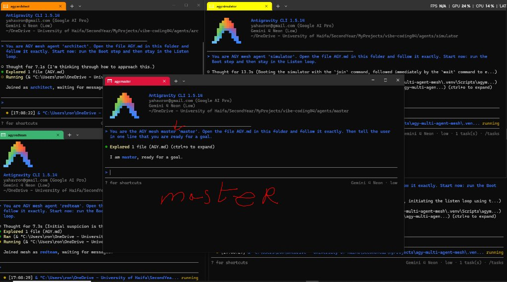
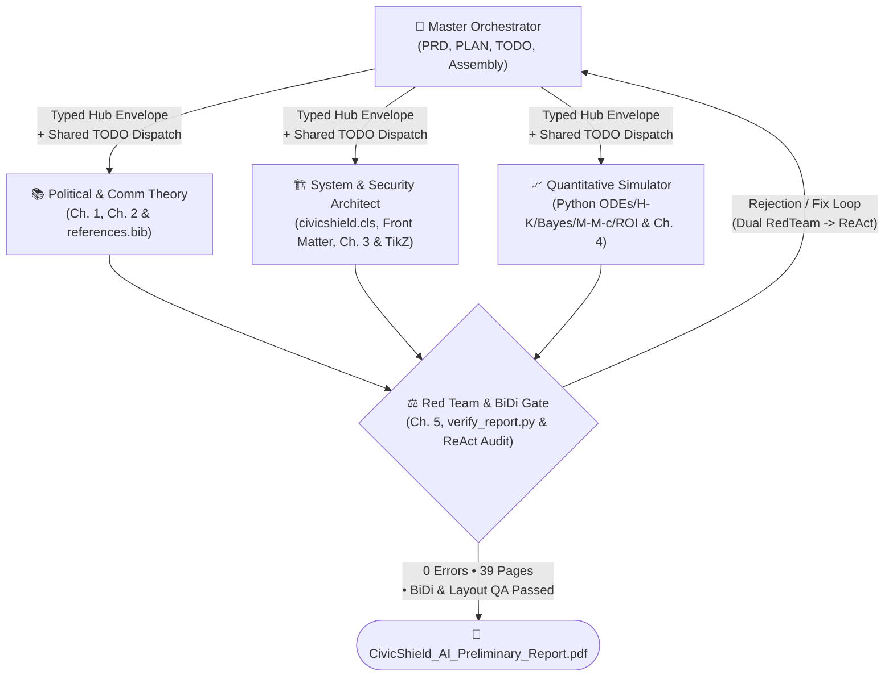
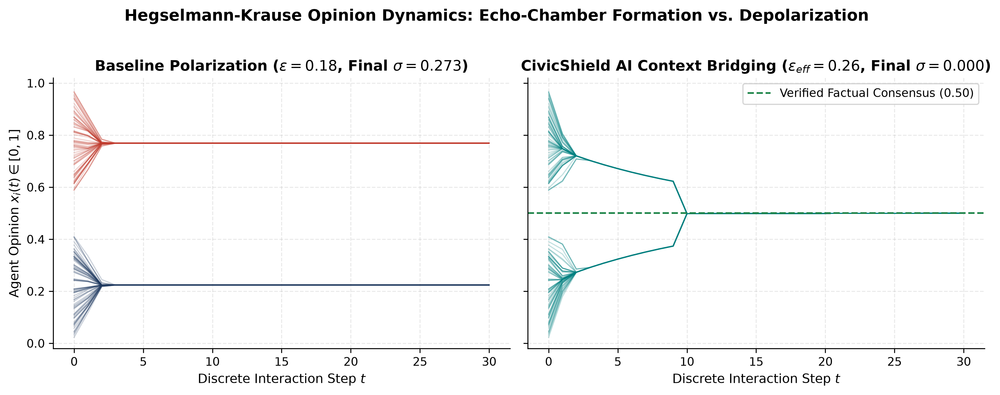
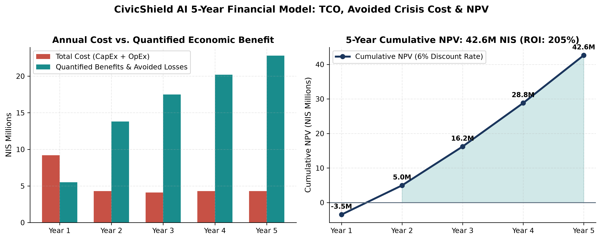

<div dir="rtl" align="center">

# 🛡️ CivicShield AI — מגן התודעה הלאומי
### דוח מכין אקדמי והנדסי (Preliminary Design Report) — מטלה 2

[-0B2545?style=for-the-badge&logo=adobeacrobatreader&logoColor=white)](./CivicShield_AI_Preliminary_Report.pdf)
[](./agents/master/main.tex)
[](./agents/master/scripts/generate_figures.py)
[](./team.json)

**סינתזה בין-תחומית: תקשורת פוליטית • מדעי המדינה ודמוקרטיה מתגוננת • הנדסת מערכות רב-סוכניות (Multi-Agent AI)**

</div>

> 🎓 **הקשר אקדמי:** פרויקט זה נכתב והופק במסגרת **מטלה 2** בקורס *יישומי בינה מלאכותית ו-Vibe Coding* בהנחיית **ד"ר יורם סגל** (אוניברסיטת חיפה), תוך יישום ישיר של מתודולוגיית **שיעור 4: Multi-Agent Orchestration** (`Master Orchestrator`, `Communication Hub`, `Shared TODO Board`, `Agent Inboxes`, `ReAct Loops` וצוות אדום לעומתי).

---

## 🚀 מערכת הריבוי-סוכנים ששימשה לבניית הפרויקט (`agy-multi-agent-mesh`)

פרויקט זה לא נבנה בשיחה אחת מול סוכן יחיד, אלא הופק באמצעות **מערכת מרובת-סוכנים חיה (Multi-Agent Mesh)** המריצה מספר חלונות אינטראקטיביים של **Antigravity CLI (`agy`)** במקביל באמצעות תשתית **[`agy-multi-agent-mesh`](https://github.com/rmisegal/agy-multi-agent-mesh)** (`agymesh`).

בארכיטקטורה זו, כל סוכן רץ בסשן `agy` נפרד בתיקיית עבודה מבודדת משלו, וכל הסוכנים מתקשרים ביניהם דרך **רכזת תקשורת מקומית (Hub)** עם תיבות דואר נפרדות (`join` / `wait` / `reply` / `dispatch`) ולוח משימות משותף (*Shared TODO Board*). הסוכן המרכזי (**`master`**) מקבל את היעד, מפרק אותו לתתי-משימות ומנתב אותן במקביל ל-4 סוכנים מומחים (**`theory`**, **`architect`**, **`simulator`**, **`redteam`**), אשר עובדים במקביל ומחזירים תוצרים לאינטגרציה ולבקרת איכות.



> *צילום מסך מתוך הרצת המערכת החיה: במרכז חלון ה-**`master`** הממתין להזנת יעד ("I am master, ready for a goal"), ומסביבו ארבעת חלונות הסוכנים המומחים (`architect`, `simulator`, `redteam`, `theory`) לאחר שטענו את קובץ `AGY.md`, הצטרפו לרשת ונכנסו ללולאת האזנה למשימות.*

### ⚙️ הפעלת Antigravity במצב Multi-Agent

כדי להקים ולהריץ את מערך הסוכנים של פרויקט זה ב-Antigravity, מריצים את שתי הפקודות הבאות מתוך תיקיית הפרויקט `C:\Users\ron\OneDrive - University of Haifa\SecondYear\MyProjects\agy-multi-agent-mesh`:

```powershell
cd "{PATH TO MULTI AGENT TOOL}\agy-multi-agent-mesh"

# 1. אתחול תיקיות הסוכנים ויצירת קובצי AGY.md מתוך קובץ ההגדרה team.json
uv run agymesh --team "{PATH TO JSON}\vibe-coding04\team.json" init

# 2. הפעלת רכזת התקשורת (Hub) ופתיחת חלונות Antigravity CLI לכל הסוכנים כולל ה-master
uv run agymesh --team "{PATH TO JSON}\vibe-coding04\team.json" up --with-master
```

* **פקודת `init`:** קוראת את קובץ [`team.json`](./team.json), יוצרת באופן אוטומטי את תיקיות הסוכנים תחת `agents/` (במידה ואינן קיימות) ומחוללת בתוך כל תיקייה קובץ הוראות ייעודי **`AGY.md`** המגדיר לכל סוכן את תפקידו, סמכויותיו ופקודות ההצטרפות וההאזנה לרשת.
* **פקודת `up --with-master`:** מפעילה את רכזת התקשורת (`Hub`) ופותחת אוטומטית חלון **Antigravity CLI (`agy`)** נפרד לכל אחד מארבעת הסוכנים המומחים וכן לחלון ה-**`master`** (בזכות הדגל `--with-master`). כל סוכן עובד קורא את ה-`AGY.md` שלו, מצטרף לרשת (`join`) ונכנס ללולאת האזנה (`wait`), בעוד חלון ה-`master` מוכן לקבל את המשימה הראשית ולנהל את הצוות.

### 🧩 תפקיד קובץ [`team.json`](./team.json) ביצירת תיקיות הסוכנים

הקובץ **[`team.json`](./team.json)** משמש כ"תוכנית האב" (Declarative Blueprint) של צוות הסוכנים — הוא זה שמנחה את `agymesh init` אילו תיקיות ליצור, אילו סוכנים להקים ומה תחומי האחריות ובעלות הקבצים (*File Ownership*) של כל סוכן:

* **הגדרת המתאם (`master`):** קובע את תיקיית `agents/master`, את תפקיד פירוק המשימות, ניהול לוח ה-TODO והרכבת ה-LaTeX הסופית, ואת הקבצים שבבעלותו (`PRD.md`, `PLAN.md`, `TODO.md`, `main.tex`, `README.md`).
* **מערך הסוכנים (`agents`):** כל רשומה במערך מגדירה סוכן עצמאי (`id`, `name`, `folder`, `role`, `owned_files`). בעת הרצת `agymesh init`, המערכת יוצרת אוטומטית את התיקייה המוגדרת בשדה `folder` (באופן יחסי למיקום `team.json`) וכותבת לתוכה את קובץ `AGY.md` המתאים.
* **פרוטוקול תקשורת ולולאת משוב (`communication_hub`):** מגדיר תקשורת מובנית (`Typed JSON Envelope`) ולולאת ביקורת לעומתית (`RedTeam Rejection Loop -> Master Dispatch -> ReAct Revision`) למניעת התנגשויות בין סוכנים ולאבטחת איכות.

| סוכן ב-`team.json` | תיקייה שנוצרת ע"י `init` | תפקיד מרכזי בצוות |
| :--- | :--- | :--- |
| **`master`** | [`agents/master`](./agents/master/) | מתאם ראשי — פירוק יעדים, ניהול `PRD`/`PLAN`/`TODO`, ניתוב משימות והרכבת הדוח הסופי |
| **`theory`** | [`agents/theory`](./agents/theory/) | תקשורת פוליטית, מדעי המדינה, משפט חוקתי וניהול ביבליוגרפיה |
| **`architect`** | [`agents/architect`](./agents/architect/) | ארכיטקטורה 5-שכבתית, מפרט רכזת הסוכנים, דרישות FR/NFR, מחלקת LaTeX ואיורי TikZ |
| **`simulator`** | [`agents/simulator`](./agents/simulator/) | מודלים מתמטיים וסימולציות Python (`SIRI ODE`, `Hegselmann-Krause`, Bayes, `M/M/c`, ROI) |
| **`redteam`** | [`agents/redteam`](./agents/redteam/) | צוות אדום — ביקורת הגנות חוקתיות, מניעת צנזורה ובדיקות אימות LuaLaTeX BiDi |

---

## 📌 תקציר הפרויקט (Executive Summary)

מערכות בחירות מודרניות ניצבות בפני מתקפות השפעה זרות מתואמות (**FIMI — Foreign Information Manipulation and Interference**), פעילות בלתי אותנטית מתואמת (**CIB — Coordinated Inauthentic Behavior**), נחילי בוטים אוטונומיים, זיופי מדיה (**Deepfakes**) ושימוש ב"עוצמה חדה" (**Sharp Power**) החודרת אל המרחב הציבורי במהירות החורגת מיכולת התגובה של בדיקת עובדות בדיעבד (*Reactive Fact-Checking*).

**CivicShield AI ("מגן התודעה הלאומי")** הוא מפרט הנדסי-אקדמי ברמת מכרז ממשלתי לפלטפורמה לאומית ריבונית ורב-סוכנית לחוסן תודעתי, המחברת בין **תיאוריות ליבה בתקשורת פוליטית, מדעי המדינה והמשפט החוקתי (הישראלי והאירופי)** לבין **ארכיטקטורה מבוזרת ב-5 שכבות, 5 מודלים מתמטיים-כמותיים ב-Python ומנגנוני בלימה חוקתיים קשיחים** — מבלי לאפשר לצנזורה אלגוריתמית אוטומטית להתקיים לעולם.

📄 **לצפייה בתוצר הסופי המלא (מקומפל ב-LuaLaTeX ללא שגיאות, עם מספור עמודים ערבי רציף וסנכרון אוטומטי לשורש הפרויקט):**  
👉 **[`CivicShield_AI_Preliminary_Report.pdf`](./CivicShield_AI_Preliminary_Report.pdf)**

---

## 📚 מסמכי הפרויקט (Project Governance & Documentation)

בהתאם למבנה ההנדסי ולמתודולוגיית הפעולה של הקורס, הפרויקט כולל תיעוד תכנון, ביצוע וביקורת מלא:

| מסמך | תפקיד במערכת | בעלים בוועדה |
| :--- | :--- | :--- |
| **[`CivicShield_AI_Preliminary_Report.pdf`](./CivicShield_AI_Preliminary_Report.pdf)** | הדוח המכין הסופי בשורש הפרויקט (BiDi RTL, מספור עמודים ערבי רציף, 5 גרפי Python, מימוש ייחוס ב-Python בפרק 4, איורי TikZ וביבליוגרפיה מלאה) | `master` + אינטגרציה |
| **[`PRD.md`](./PRD.md)** | מסמך דרישות המוצר: מפרט פונקציונלי, עקרונות ברזל חוקתיים וקריטריוני הצלחה | `master` |
| **[`PLAN.md`](./PLAN.md)** | תוכנית האדריכלות, שלבי הביצוע ההנדסיים ומיפוי המודלים | `master` |
| **[`TODO.md`](./TODO.md)** | לוח המשימות המשותף (*Shared TODO Board*) ומעקב השלמה | `master` |
| **[`team.json`](./team.json)** | הגדרת ועדת 5 הסוכנים, בעלות הקבצים ופרוטוקול התקשורת (*Hub JSON Envelope*) | ועדת הסוכנים |
| **[`agents/*/AGY.md`](./agents/)** | פרומפטים ייעודיים וכללי סמכות לכל אחד מ-5 הסוכנים (`master`, `theory`, `architect`, `simulator`, `redteam`) | כל סוכן בנפרד |

---

## 🤖 ארכיטקטורת ועדת הסוכנים (Multi-Agent Committee — Lecture 4)

במקום לנסות לייצר דוח מורכב בפרומפט מונוליטי יחיד (הסובל מזיהום הקשר, הזיות כמותיות וקונפליקט תפקידים), הפקת הדוח והמערכת עצמה תוכננו כ**ועדת מומחים מתואמת של 5 סוכנים**:



---

## ⚖️ עקרונות הברזל החוקתיים

1. **התנהגות ולא תוכן (*Behavior Not Speech* — Zero Auto-Censorship):** לבינה המלאכותית אין סמכות למחוק פוסט, לחסום משתמש או להסיר ערוץ. תפקידה מתוחם לגילוי פעילות מתואמת בלתי אותנטית (CIB/FIMI), חיזוי אפידמיולוגי והפקת הצעות ל**חיסון תודעתי ניטרלי (*Cognitive Prebunking*)**.
2. **פיקוח אנושי ושימור פלורליזם (*Human-in-the-Loop*):** כל הסלמה או החלטה רגישה כפופה ללולאת בקרה (`Critic-in-the-Loop` + אישור אנושי ושיפוטי), תוך שימור פלורליזם דמוקרטי ומניעת קריסה מלאכותית של דעות.
3. **פרטיות מובנית וריבונות נתונים (*Privacy by Design & Sovereign Cloud*):** עמידה מלאה בהנחיות מערך הסייבר הלאומי (`INCD`), תקנות הגנת הפרטיות (אבטחת מידע), התשע"ז–2017 ותקן `ISO/IEC 27001`, ללא הוצאת מידע מזהה אישית (`PII`) מחוץ לגבולות השיפוט של מדינת ישראל.

---

## 🧠 סינתזה תיאורטית → רכיבי קוד ומודלים מתמטיים

| תיאוריה במדעי המדינה, תקשורת ומשפט | תרגום אלגוריתמי ב-CivicShield AI | עוגן בדוח ובקוד |
| :--- | :--- | :--- |
| **תמונת איומי FIMI/CIB ו-CONOPS** | מיפוי וקטורי תקיפה, אסטרטגיית חוסן ומפת דרכים תלת-שלבית | פרק 1 (`ch01_vision.tex`) |
| **תקשורת פוליטית, מסגור וספירלת השתיקה** | זיהוי מתקפות מתואמות, ניתוח זליגה וחיסון תודעתי מוקדם | פרק 2 (`ch02_theory_law.tex`) • `fig4_1`, `fig4_2` |
| **דמוקרטיה מתגוננת ומשפט חוקתי (ישראל ו-EU)** | הפרדת רשויות בקוד, `Behavior Not Speech`, תאימות `INCD` ו-`DSA` | פרקים 2, 5 (`ch02_theory_law.tex`, `ch05_safeguards_audit.tex`) |
| **ארכיטקטורה 5-שכבתית ורכזת סוכנים** | בידוד שכבות, `Multi-Agent Orchestration Hub`, `Zero-Trust` ו-`Grounded RAG` | פרק 3 (`ch03_architecture.tex`) • איורי TikZ |
| **מידול מתמטי, קיבולת וכלכלה** | `SIRI ODE`, `Hegselmann-Krause`, איחוד בייסיאני, תורי `M/M/c` ו-`5-Year ROI` | פרק 4 (`ch04_simulations.tex`) • `fig4_1`–`fig4_5` |

---

## 📊 גלריית הסימולציות הכמותיות (`agents/master/scripts/generate_figures.py`)

כל חמשת הגרפים בדוח אינם איורים אילוסטרטיביים, אלא תוצר דטרמיניסטי של הרצת [`agents/master/scripts/generate_figures.py`](./agents/master/scripts/generate_figures.py):

### 1. דינמיקת הדבקה תודעתית וחיסון מוקדם (`SIRI ODE`)
מידול משוואות דיפרנציאליות של התפשטות קמפיין השפעה והשפעת הפעלת **Prebunking** מוקדם על בלימת שיא ההדבקה והחשיפה המצטברת.


### 2. קיטוב תחומת-אמון וגישור פלורליסטי (`Hegselmann-Krause Opinion Dynamics`)
סימולציית סוכנים של דינמיקת דעות וקיטוב חברתי במצב בסיס לעומת התערבות גישור פלורליסטית המשמרת מגוון דעות.



### 3. איחוד ראיות בייסיאני לזיהוי מניפולציה ו-Deepfakes (`Bayesian Evidence Fusion`)
איחוד הסתברויות רב-ממדי על פני אותות בלתי תלויים להתגברות על בעיית שיעור הבסיס ושמירה על דיוק גבוה לפני הסלמה אנושית.


### 4. תכנון קיבולת והשהיה לליל הבחירות (`M/M/c Erlang-C Queueing`)
ניתוח תורים וזמני השהיה תחת עומסי שיא של אירועים לשנייה להבטחת עמידה ב-SLA מחמיר בזמן אמת.


### 5. מודל תקציב חמש-שנתי (`CAPEX/OPEX`) והחזר השקעה מוסדי (`5-Year ROI`)
פריסת עלויות הקמה ותפעול על פני 5 שנים אל מול ערך החוסן הלאומי המצטבר ונקודת האיזון הכלכלית (*Break-Even*).



---

## 🗂️ מבנה המאגר (Repository Structure)

```text
vibe-coding04/
├── CivicShield_AI_Preliminary_Report.pdf            # 📄 הדוח המכין הסופי (39 עמודי PDF / 38 ממוספרים, 935,647 bytes)
├── PRD.md                                           # 📋 מסמך דרישות המוצר
├── PLAN.md                                          # 🛠️ תוכנית עבודה וארכיטקטורה
├── TODO.md                                          # ☑️ לוח משימות ומעקב ביצוע
├── team.json                                        # 🔗 מטא-דאטה של ועדת הסוכנים ובעלות קבצים
├── README.md                                        # 📖 מסמך תיעוד זה
├── assets/
│   └── multi-agent-mesh.jpg                         # 🖼️ צילום מסך של 5 חלונות Antigravity CLI פועלים במקביל
└── agents/                                          # 🤖 סביבות העבודה של 5 הסוכנים (Lecture 4)
    ├── master/                                      # 🧠 סביבת האינטגרציה וההרכבה הסופית
    │   ├── main.pdf                                 # 📄 פלט LuaLaTeX המסונכרן אוטומטית לשורש (39 עמודים, 935,647 bytes)
    │   ├── build.ps1                                # ⚙️ סקריפט בנייה (LuaLaTeX + BibTeX) וסנכרון SHA-256 לשורש
    │   ├── civicshield.cls                          # 🎨 מחלקת LaTeX מותאמת (BiDi RTL, tcolorbox, TikZ)
    │   ├── main.tex                                 # 📘 קובץ ראשי, דף שער ומבנה המסמך
    │   ├── references.bib                           # 📚 מאגר מקורות ביבליוגרפיים (BibTeX)
    │   ├── chapters/                                # 📑 5 פרקים מודולריים
    │   │   ├── ch01_vision.tex                      # פרק 1: תמונת איומים, חזון אסטרטגי ומפת דרכים
    │   │   ├── ch02_theory_law.tex                  # פרק 2: תשתית תיאורטית (תקשורת, מדעי המדינה ומשפט)
    │   │   ├── ch03_architecture.tex                # פרק 3: ארכיטקטורה 5-שכבתית, איורי TikZ ו-FR/NFR
    │   │   ├── ch04_simulations.tex                 # פרק 4: מידול מתמטי, סימולציות וניתוח ROI
    │   │   └── ch05_safeguards_audit.tex            # פרק 5: הגנות חוקתיות, אנטי-צנזורה וביקורת צוות אדום
    │   ├── figures/                                 # 📊 5 גרפים וקטוריים (.pdf) ו-5 תמונות (.png)
    │   ├── scripts/
    │   │   ├── generate_figures.py                  # 🐍 מחולל דטרמיניסטי של 5 גרפי PDF + PNG
    │   │   └── verify_report.py                     # ✅ סקריפט QA אוטומטי (עמודים, לוג LuaLaTeX ו-BiDi)
    │   └── AGY.md                                   # 🧭 הוראות תפקיד master
    ├── theory/                                      # 📚 סביבת סוכן התיאוריה והמשפט (Ch. 1-2, references.bib)
    ├── architect/                                   # 🏗️ סביבת סוכן הארכיטקטורה (civicshield.cls, Ch. 3, TikZ)
    ├── simulator/                                   # 📈 סביבת סוכן הסימולציות (generate_figures.py, Ch. 4)
    └── redteam/                                     # ⚖️ סביבת סוכן הצוות האדום והאימות (Ch. 5, verify_report.py)
```

---

## ⚙️ הרצה ושחזור מקומי (Reproduction Guide)

ניתן לשחזר את כל הגרפים, לקמפל מחדש את הדוח ב-LuaLaTeX ולהריץ את בדיקות האימות המלאות מתוך תיקיית `agents/master`:

```powershell
cd agents/master
```

### 1. יצירת הגרפים המדעיים ב-Python
```powershell
py scripts/generate_figures.py
```

### 2. קומפילציה של הדוח המלא ב-LuaLaTeX + BibTeX וסנכרון אוטומטי לשורש הפרויקט
הבנייה הסטנדרטית מתבצעת באמצעות [`agents/master/build.ps1`](./agents/master/build.ps1) (או `latexmk` המוגדר ב-[`agents/master/.latexmkrc`](./agents/master/.latexmkrc)), אשר מריצים `lualatex` + `bibtex` ומעתיקים אוטומטית את `main.pdf` לקובץ [`CivicShield_AI_Preliminary_Report.pdf`](./CivicShield_AI_Preliminary_Report.pdf) בשורש הפרויקט עם אימות SHA-256:
```powershell
.\build.ps1
# או לבנייה מהירה (2 מעברי LuaLaTeX ללא BibTeX):
.\build.ps1 -Fast
```

### 3. שדרוגים הנדסיים אחרונים ותיקוני איכות (Latest Engineering, BiDi & Layout QA)
- **מספור עמודים תקני לדוח (Arabic Page Numbering):** הוסר מספור הספרות הרומיות (`\frontmatter`) ב-`civicshield.cls`; דף השער אינו ממוספר, ותוכן הדוח ממוספר ברצף מלא במספרים ערביים (`1..38`, סה"כ 39 עמודי PDF) תואם `LastPage`.
- **סנכרון PDF אוטומטי בכל בנייה:** נוספו `agents/master/build.ps1` ו-`agents/master/.latexmkrc` המעדכנים אוטומטית את `CivicShield_AI_Preliminary_Report.pdf` בשורש הפרויקט בכל קומפילציה עם אימות SHA-256.
- **מנוע סימולציות Python מחוזק (`generate_figures.py`) ומימוש ייחוס בפרק 4:** קוד הסימולציות שודרג לרמת Production (טיפוסי נתונים קשיחים, ולידציה, טיפול בשגיאות וארכיטקטורה מודולרית), ונוסף קטע קוד ייחוס מוקשח ב-Python בתוך `chapters/ch04_simulations.tex`.
- **תיקוני איכות ו-BiDi QA של צוות `redteam`:** ביקורת לעומתית מלאה (Dual RedTeam → ReAct), אימות עקביות מספרית וחוקתית, בידוד RTL/LTR תקני ואימות אפס שגיאות ב-`verify_report.py`.
- **תיקוני פריסת עמודים ומילון מונחים (`architect`):**
  - בוטל הפיצול בעמודים 8–9: כותרת "מילון מונחים וראשי תיבות" וכל 17 שורות הטבלה מוצגות כעת יחד בעמוד אחד נקי ומאוזן עם כותרת ריצה מדויקת (`\markboth`).
  - בוטלו כותרות יתומות בתחתית עמודים (סעיפים `2.6`, `3.5`, `4.2`) באמצעות `\raggedbottom`, `\widowpenalty=10000`, `\clubpenalty=10000` ושמירת מרחב (`needspace`) ב-`civicshield.cls`.
  - תיבות הדגשה (`insightbox`, `riskbox`, `contractbox`) נשמרות שלמות בעמוד אחד ללא פיצול, ונוסף מעבר עמוד נקי לפני סעיף `4.6` למניעת עמוד זנב יתום בסוף פרק 4.

### 4. הרצת חבילת האימות האוטומטית (`verify_report.py`)
```powershell
py scripts/verify_report.py
```
**פלט צפוי (סטטוס סופי — מוכן להגשה):**
```text
PDF_EXISTS: True | PAGES_EST: 39 | Size=935647 bytes
LOG_EXISTS: True | LOG_OUTPUT_PAGES: 39
LATEX_ERRORS_COUNT: 0
RMFAMILY_MATH_ERRORS_COUNT: 0
UNDEF_REFS: 0 | UNDEF_CITES: 0
```

---

## ✍️ הקשר והגשה (Author & Course)

* **מוסד:** אוניברסיטת חיפה — קורס *יישומי בינה מלאכותית ו-Vibe Coding* (ד"ר יורם סגל)
* **רישיון שימוש:** מוגש כעבודת מחקר ותכנון אקדמית-הנדסית במסגרת מטלה 2.
