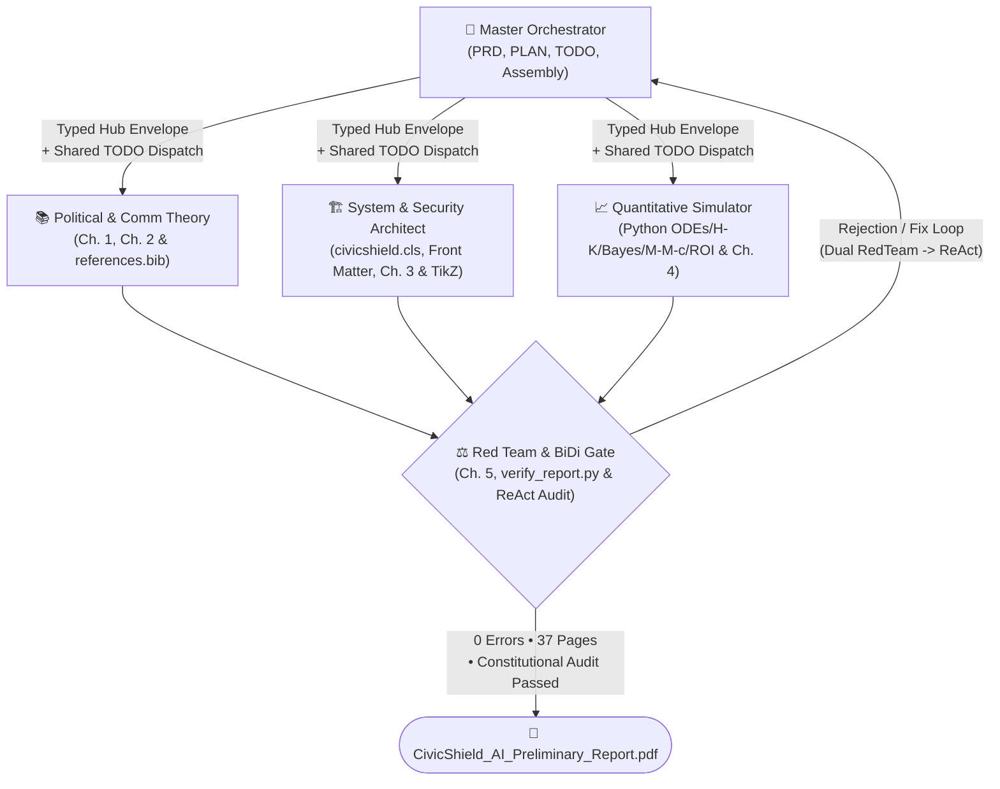
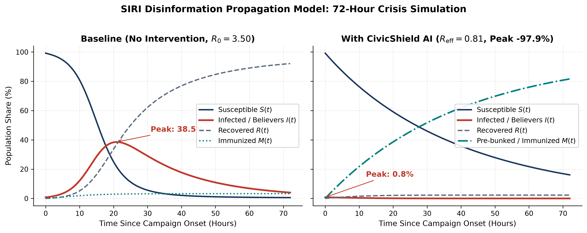
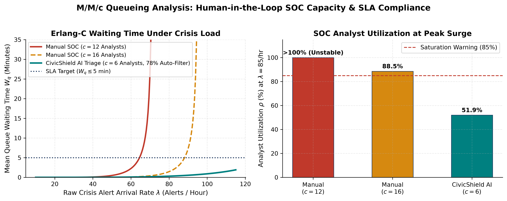

<div dir="rtl" align="center">

# 🛡️ CivicShield AI — מגן התודעה הלאומי
### דוח מכין אקדמי והנדסי (Preliminary Design Report) — מטלה 2

[-0B2545?style=for-the-badge&logo=adobeacrobatreader&logoColor=white)](./agents/master/CivicShield_AI_Preliminary_Report.pdf)
[](./agents/master/main.tex)
[](./agents/master/scripts/generate_figures.py)
[](./team.json)

**סינתזה בין-תחומית: תקשורת פוליטית • מדעי המדינה ודמוקרטיה מתגוננת • הנדסת מערכות רב-סוכניות (Multi-Agent AI)**

</div>

> 🎓 **הקשר אקדמי:** פרויקט זה נכתב והופק במסגרת **מטלה 2** בקורס *יישומי בינה מלאכותית ו-Vibe Coding* בהנחיית **ד"ר יורם סגל** (אוניברסיטת חיפה), תוך יישום ישיר של מתודולוגיית **שיעור 4: Multi-Agent Orchestration** (`Master Orchestrator`, `Communication Hub`, `Shared TODO Board`, `Agent Inboxes`, `ReAct Loops` וצוות אדום לעומתי).

---

## 📌 תקציר הפרויקט (Executive Summary)

מערכות בחירות מודרניות ניצבות בפני מתקפות השפעה זרות מתואמות (**FIMI — Foreign Information Manipulation and Interference**), פעילות בלתי אותנטית מתואמת (**CIB — Coordinated Inauthentic Behavior**), נחילי בוטים אוטונומיים, זיופי מדיה (**Deepfakes**) ושימוש ב"עוצמה חדה" (**Sharp Power**) החודרת אל המרחב הציבורי במהירות החורגת מיכולת התגובה של בדיקת עובדות בדיעבד (*Reactive Fact-Checking*).

**CivicShield AI ("מגן התודעה הלאומי")** הוא מפרט הנדסי-אקדמי ברמת מכרז ממשלתי לפלטפורמה לאומית ריבונית ורב-סוכנית לחוסן תודעתי, המחברת בין **תיאוריות ליבה בתקשורת פוליטית, מדעי המדינה והמשפט החוקתי (הישראלי והאירופי)** לבין **ארכיטקטורה מבוזרת ב-5 שכבות, 5 מודלים מתמטיים-כמותיים ב-Python ומנגנוני בלימה חוקתיים קשיחים** — מבלי לאפשר לצנזורה אלגוריתמית אוטומטית להתקיים לעולם.

📄 **לצפייה בתוצר הסופי המלא (37 עמודים, מקומפל ב-LuaLaTeX ללא שגיאות):**  
👉 **[`agents/master/CivicShield_AI_Preliminary_Report.pdf`](./agents/master/CivicShield_AI_Preliminary_Report.pdf)**

---

## 📚 מסמכי הפרויקט (Project Governance & Documentation)

בהתאם למבנה ההנדסי ולמתודולוגיית הפעולה של הקורס, הפרויקט כולל תיעוד תכנון, ביצוע וביקורת מלא:

| מסמך | תפקיד במערכת | בעלים בוועדה |
| :--- | :--- | :--- |
| **[`agents/master/CivicShield_AI_Preliminary_Report.pdf`](./agents/master/CivicShield_AI_Preliminary_Report.pdf)** | הדוח המכין הסופי (37 עמודים, BiDi RTL, 5 גרפי Python, איורי TikZ טהורים וביבליוגרפיה מלאה) | `master` + אינטגרציה |
| **[`PRD.md`](./PRD.md)** | מסמך דרישות המוצר: מפרט פונקציונלי, עקרונות ברזל חוקתיים וקריטריוני הצלחה | `master` |
| **[`PLAN.md`](./PLAN.md)** | תוכנית האדריכלות, שלבי הביצוע ההנדסיים ומיפוי המודלים | `master` |
| **[`TODO.md`](./TODO.md)** | לוח המשימות המשותף (*Shared TODO Board*) ומעקב השלמה | `master` |
| **[`team.json`](./team.json)** | הגדרת ועדת 5 הסוכנים, בעלות הקבצים ופרוטוקול התקשורת (*Hub JSON Envelope*) | ועדת הסוכנים |
| **[`agents/*/AGY.md`](./agents/)** | פרומפטים ייעודיים וכללי סמכות לכל אחד מ-5 הסוכנים (`master`, `theory`, `architect`, `simulator`, `redteam`) | כל סוכן בנפרד |

---

## 🤖 ארכיטקטורת ועדת הסוכנים (Multi-Agent Committee — Lecture 4)

במקום לנסות לייצר דוח מורכב בפרומפט מונוליטי יחיד (הסובל מזיהום הקשר, הזיות כמותיות וקונפליקט תפקידים), הפקת הדוח והמערכת עצמה תוכננו כ**ועדת מומחים מתואמת של 5 סוכנים**:



---

## ⚖️ עקרונות הברזל החוקתיים

1. **התנהגות ולא תוכן (*Behavior Not Speech* — Zero Auto-Censorship):** לבינה המלאכותית אין סמכות למחוק פוסט, לחסום משתמש או להסיר ערוץ. תפקידה מתוחם לגילוי פעילות מתואמת בלתי אותנטית (CIB/FIMI), חיזוי אפידמיולוגי והפקת הצעות ל**חיסון תודעתי ניטרלי (*Cognitive Prebunking*)**.
2. **פיקוח אנושי ושימור פלורליזם (*Human-in-the-Loop*):** כל הסלמה או החלטה רגישה כפופה ללולאת בקרה (`Critic-in-the-Loop` + אישור אנושי ושיפוטי), תוך שימור פלורליזם דמוקרטי ומניעת קריסה מלאכותית של דעות.
3. **פרטיות מובנית וריבונות נתונים (*Privacy by Design & Sovereign Cloud*):** עמידה מלאה בהנחיות מערך הסייבר הלאומי (`INCD`), תקנות הגנת הפרטיות (אבטחת מידע), התשע"ז–2017 ותקן `ISO/IEC 27001`, ללא הוצאת מידע מזהה אישית (`PII`) מחוץ לגבולות השיפוט של מדינת ישראל.

---

## 🧠 סינתזה תיאורטית → רכיבי קוד ומודלים מתמטיים

| תיאוריה במדעי המדינה, תקשורת ומשפט | תרגום אלגוריתמי ב-CivicShield AI | עוגן בדוח ובקוד |
| :--- | :--- | :--- |
| **תמונת איומי FIMI/CIB ו-CONOPS** | מיפוי וקטורי תקיפה, אסטרטגיית חוסן ומפת דרכים תלת-שלבית | פרק 1 (`ch01_vision.tex`) |
| **תקשורת פוליטית, מסגור וספירלת השתיקה** | זיהוי מתקפות מתואמות, ניתוח זליגה וחיסון תודעתי מוקדם | פרק 2 (`ch02_theory_law.tex`) • `fig4_1`, `fig4_2` |
| **דמוקרטיה מתגוננת ומשפט חוקתי (ישראל ו-EU)** | הפרדת רשויות בקוד, `Behavior Not Speech`, תאימות `INCD` ו-`DSA` | פרקים 2, 5 (`ch02_theory_law.tex`, `ch05_safeguards_audit.tex`) |
| **ארכיטקטורה 5-שכבתית ורכזת סוכנים** | בידוד שכבות, `Multi-Agent Orchestration Hub`, `Zero-Trust` ו-`Grounded RAG` | פרק 3 (`ch03_architecture.tex`) • איורי TikZ |
| **מידול מתמטי, קיבולת וכלכלה** | `SIRI ODE`, `Hegselmann-Krause`, איחוד בייסיאני, תורי `M/M/c` ו-`5-Year ROI` | פרק 4 (`ch04_simulations.tex`) • `fig4_1`–`fig4_5` |

---

## 📊 גלריית הסימולציות הכמותיות (`agents/master/scripts/generate_figures.py`)

כל חמשת הגרפים בדוח אינם איורים אילוסטרטיביים, אלא תוצר דטרמיניסטי של הרצת [`agents/master/scripts/generate_figures.py`](./agents/master/scripts/generate_figures.py):

### 1. דינמיקת הדבקה תודעתית וחיסון מוקדם (`SIRI ODE`)
מידול משוואות דיפרנציאליות של התפשטות קמפיין השפעה והשפעת הפעלת **Prebunking** מוקדם על בלימת שיא ההדבקה והחשיפה המצטברת.



### 2. קיטוב תחומת-אמון וגישור פלורליסטי (`Hegselmann-Krause Opinion Dynamics`)
סימולציית סוכנים של דינמיקת דעות וקיטוב חברתי במצב בסיס לעומת התערבות גישור פלורליסטית המשמרת מגוון דעות.


### 3. איחוד ראיות בייסיאני לזיהוי מניפולציה ו-Deepfakes (`Bayesian Evidence Fusion`)
איחוד הסתברויות רב-ממדי על פני אותות בלתי תלויים להתגברות על בעיית שיעור הבסיס ושמירה על דיוק גבוה לפני הסלמה אנושית.


### 4. תכנון קיבולת והשהיה לליל הבחירות (`M/M/c Erlang-C Queueing`)
ניתוח תורים וזמני השהיה תחת עומסי שיא של אירועים לשנייה להבטחת עמידה ב-SLA מחמיר בזמן אמת.



### 5. מודל תקציב חמש-שנתי (`CAPEX/OPEX`) והחזר השקעה מוסדי (`5-Year ROI`)
פריסת עלויות הקמה ותפעול על פני 5 שנים אל מול ערך החוסן הלאומי המצטבר ונקודת האיזון הכלכלית (*Break-Even*).


---

## 🗂️ מבנה המאגר (Repository Structure)

```text
vibe-coding04/
├── PRD.md                                           # 📋 מסמך דרישות המוצר
├── PLAN.md                                          # 🛠️ תוכנית עבודה וארכיטקטורה
├── TODO.md                                          # ☑️ לוח משימות ומעקב ביצוע
├── team.json                                        # 🔗 מטא-דאטה של ועדת הסוכנים ובעלות קבצים
├── README.md                                        # 📖 מסמך תיעוד זה
└── agents/                                          # 🤖 סביבות העבודה של 5 הסוכנים (Lecture 4)
    ├── master/                                      # 🧠 סביבת האינטגרציה וההרכבה הסופית
    │   ├── CivicShield_AI_Preliminary_Report.pdf    # 📄 הדוח המכין הסופי (37 עמודים, 874,740 bytes)
    │   ├── civicshield.cls                          # 🎨 מחלקת LaTeX מותאמת (BiDi RTL, tcolorbox, TikZ)
    │   ├── main.tex                                 # 📘 קובץ ראשי, דף שער ומבנה המסמך
    │   ├── references.bib                           # 📚 מאגר מקורות ביבליוגרפיים (BibTeX)
    │   ├── chapters/                                # 📑 5 פרקים מודולריים
    │   │   ├── ch01_vision.tex                      # פרק 1: תמונת איומים, חזון אסטרטגי ומפת דרכים
    │   │   ├── ch02_theory_law.tex                  # פרק 2: תשתית תיאורטית (תקשורת, מדעי המדינה ומשפט)
    │   │   ├── ch03_architecture.tex                # פרק 3: ארכיטקטורה 5-שכבתית, איורי TikZ ו-FR/NFR
    │   │   ├── ch04_simulations.tex                 # פרק 4: מידול מתמטי, סימולציות וניתוח ROI
    │   │   └── ch05_safeguards_audit.tex            # פרק 5: הגנות חוקתיות, אנטי-צנזורה וביקורת צוות אדום
    │   ├── figures/                                 # 📊 5 גרפים וקטוריים (.pdf) ו-5 תמונות (.png)
    │   ├── scripts/
    │   │   ├── generate_figures.py                  # 🐍 מחולל דטרמיניסטי של 5 גרפי PDF + PNG
    │   │   └── verify_report.py                     # ✅ סקריפט QA אוטומטי (עמודים, לוג LuaLaTeX ו-BiDi)
    │   └── AGY.md                                   # 🧭 הוראות תפקיד master
    ├── theory/                                      # 📚 סביבת סוכן התיאוריה והמשפט (Ch. 1-2, references.bib)
    ├── architect/                                   # 🏗️ סביבת סוכן הארכיטקטורה (civicshield.cls, Ch. 3, TikZ)
    ├── simulator/                                   # 📈 סביבת סוכן הסימולציות (generate_figures.py, Ch. 4)
    └── redteam/                                     # ⚖️ סביבת סוכן הצוות האדום והאימות (Ch. 5, verify_report.py)
```

---

## ⚙️ הרצה ושחזור מקומי (Reproduction Guide)

ניתן לשחזר את כל הגרפים, לקמפל מחדש את הדוח ב-LuaLaTeX ולהריץ את בדיקות האימות המלאות מתוך תיקיית `agents/master`:

```powershell
cd agents/master
```

### 1. יצירת הגרפים המדעיים ב-Python
```powershell
py scripts/generate_figures.py
```

### 2. קומפילציה של הדוח המלא ב-LuaLaTeX + BibTeX
```powershell
lualatex -interaction=nonstopmode main.tex
bibtex main
lualatex -interaction=nonstopmode main.tex
lualatex -interaction=nonstopmode main.tex
Copy-Item main.pdf CivicShield_AI_Preliminary_Report.pdf -Force
```

### 3. הרצת חבילת האימות האוטומטית (`verify_report.py`)
```powershell
py scripts/verify_report.py
```
**פלט צפוי:**
```text
PDF_EXISTS: True | PAGES_EST: 37 | Size=874740 bytes
LOG_EXISTS: True | LOG_OUTPUT_PAGES: 37
LATEX_ERRORS_COUNT: 0
RMFAMILY_MATH_ERRORS_COUNT: 0
UNDEF_REFS: 0 | UNDEF_CITES: 0
```

---

## ✍️ הקשר והגשה (Author & Course)

* **מוסד:** אוניברסיטת חיפה — קורס *יישומי בינה מלאכותית ו-Vibe Coding* (ד"ר יורם סגל)
* **רישיון שימוש:** מוגש כעבודת מחקר ותכנון אקדמית-הנדסית במסגרת מטלה 2.
